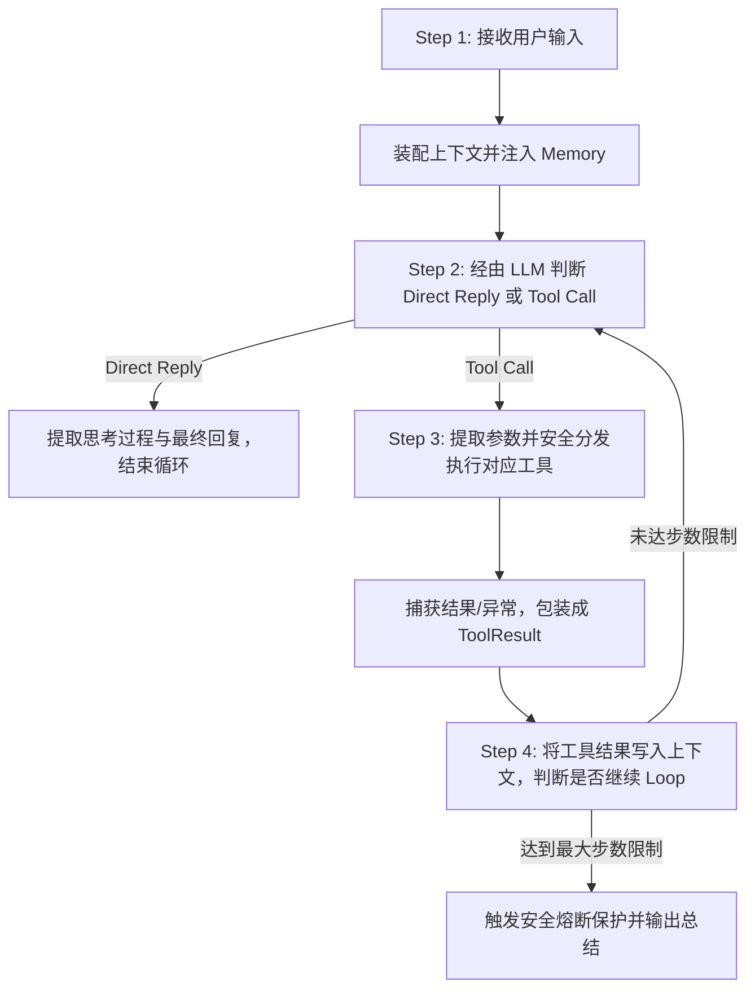

# Zero-Framework Minimal Agent Runtime

> 2026 年 Agent Harness 技术笔试题实现 —— 基于 **DeepSeek API** 从零实现的最小可用自主 Agent。
> 纯手写核心 Runtime，**零依赖** LangGraph / OpenHands / OpenClaw 等现成 Agent 框架。

---

## 目录
1. [项目亮点](#项目亮点)
2. [系统架构设计](#系统架构设计)
3. [核心执行循环 (4-Step Loop)](#核心执行循环-4-step-loop)
4. [Memory 机制设计：召回时机与放置方式](#memory-机制设计召回时机与放置方式)
5. [工具系统 (Tool Registry)](#工具系统-tool-registry)
6. [多 Session 窗口隔离机制](#多-session-窗口隔离机制)
7. [Context 上下文有效管理与压缩](#context-上下文有效管理与压缩)
8. [快速上手指南](#快速上手指南)
9. [测试用例验证](#测试用例验证)
10. [安全规范](#安全规范)

---

## 项目亮点

- **真正的从零构建 (Zero-Framework)**：自行设计并实现 Agent Runtime、事件循环、工具调度器、上下文压缩器与多会话管理器。
- **真实 LLM 驱动**：全面对接 **DeepSeek API** (`deepseek-chat`)，支持原生 Function Calling 及思考过程（Reasoning/Thought）提取。
- **会话绝对隔离**：支持多窗口并发与持久化（如窗口 1 查天气加待办 vs 窗口 2 写周报加待办），状态与 Todo 存储天然物理隔离。
- **安全可控的工具执行**：内置 `SafeCalculator`（基于 Python AST 解析语法树，严禁 `eval()` 杜绝代码注入攻击）。
- **完善的测试覆盖**：23 个全方位单元测试与真实 API 端到端集成测试，测试通过率 100%。

---

## 系统架构设计

```
┌───────────────────────────────────────────────────────────────┐
│                       Agent Runtime                           │
│  ┌────────────────┐     ┌────────────────┐     ┌───────────┐  │
│  │ SessionManager │ ──> │ ContextManager │ ──> │ DeepSeek  │  │
│  │ (Window 1/2)   │     │ (Window/Compact│     │ Client    │  │
│  └────────────────┘     └────────────────┘     └─────┬─────┘  │
│                                                      │        │
│                         Loop Decision                │        │
│                   ┌──────────────────────┐           │        │
│                   │ Direct vs Tool Call? │ <─────────┘        │
│                   └──────────┬───────────┘                    │
│                 Tool Call    │    Direct Response             │
│            ┌─────────────────┴─────────────────┐              │
│            ▼                                   ▼              │
│   ┌─────────────────┐                 ┌─────────────────┐     │
│   │  Tool Registry  │                 │  Final Answer   │     │
│   │ ┌─────────────┐ │                 │  + TraceLog     │     │
│   │ │ calculator  │ │                 └─────────────────┘     │
│   │ │ search      │ │                                         │
│   │ │ todo        │ │                                         │
│   │ │ weather     │ │                                         │
│   │ └─────────────┘ │                                         │
│   └────────┬────────┘                                         │
│            │                                                  │
│            └──────> Loop back into Context ───────────────────┘
```

---

## 核心执行循环 (4-Step Loop)

运行时严格按照题目要求的 4 步循环执行：



- **Step 1（接收输入）**：接收用户 Prompt，通过 `SessionManager` 定位到独立窗口会话，写入该 Session 的上下文管理器。
- **Step 2（自主决策与解析）**：调用 DeepSeek 模型，基于注册工具的 JSON Schema 自主决策是直接回答还是调用工具；解析出思考过程（`thought`）、函数调用（`tool_calls`）或回答。
- **Step 3（工具执行与容错）**：`ToolRegistry` 动态查找并安全执行工具。捕获任何参数异常或运行时异常，将错误作为 Observation 反馈给模型，实现自愈自纠错。
- **Step 4（循环判断与终结）**：若工具产生结果，以 `role="tool"` 塞回上下文，再次触发 Step 2，由模型观察结果并决定下一步行动，直至模型输出最终回复或达到最大迭代步数（防死循环熔断）。

---

## Memory 机制设计：召回时机与放置方式

长效记忆（Memory）对于长程任务和跨轮次对话至关重要。本项目系统设计如下：

### 1. 记忆的召回时机 (Recall Timing)

记忆不能盲目无条件地全量塞入每一轮对话，应根据交互阶段采用**两阶段召回**策略：

| 召回阶段 | 触发时机 | 机制与策略 | 适用场景 |
|---------|---------|-----------|---------|
| **静态预置召回 (Pre-turn Retrieval)** | 用户每次输入之后、LLM 生成之前 | 将用户核心静态偏好（如语言、城市、常用角色）常驻或通过关键词命中召回 | 用户基础画像、全局偏好 |
| **动态意图召回 (On-demand Tool Retrieval)** | Agent 执行 Step 2 决策时 | 当用户提到“我上周说的那件事”时，Agent 自主调用 `memory_search` 工具去持久化知识库检索 | 历史碎片事实、久远对话细节 |

### 2. 记忆的放置方式 (Placement Strategy)

记忆在 Context 中的放置层级直接决定了 LLM 的注意力分配（Attention Weight）和遵从度：

```
[System Prompt]
  ├── System Base Instructions (系统核心人设与工具使用原则)
  ├── [Long-term Memory / User Profile] (召回的用户长期记忆，置于系统提示词中段)
  └── [Summary of Prior Conversation] (因窗口超限触发压缩的历史摘要)
[Conversation Context (Sliding Window)]
  ├── Recent User Message (最近轮次用户消息)
  ├── Recent Assistant Message (包含思考链与 tool_calls)
  └── Tool Observation Messages (工具执行返回)
```

- **放在 System Prompt 专辟区域（推荐做法）**：
  - 避免被后续的滑动窗口挤出；
  - 维持对整场对话的全局注意力锚定；
  - 格式清晰区分：`[Long-term Memory / Known User Context]`。
- **结合滑动窗口与结构化压缩**：
  - 局部记忆保留在近期消息中；
  - 远期记忆通过 Compaction 提炼为结构化摘要，追加在系统提示词底部。

---

## 工具系统 (Tool Registry)

所有工具包含**名称 (name)**、**功能描述 (description)** 和符合 JSON Schema 规范的**参数描述 (parameters)**。

| 工具名称 | 功能描述 | 参数要求 | 容错/安全设计 |
|---------|---------|---------|-------------|
| `calculator` | 安全数学表达式计算 | `expression: str` | 基于 Python `ast` 抽象语法树解析，禁用 `eval()`，支持 `+,-,*,/,**,sqrt,sin,log,round` |
| `search` | 知识与全网搜索 | `query: str` | 内置模拟数据与兜底泛化引擎，提供结构化信息 |
| `todo` | 待办事项 CRUD（增删查改） | `action: str, title: str?, todo_id: int?, priority: str?` | 支持 `add`, `list`, `complete`, `delete`，**物理绑定 Session ID**，多窗口待办互不干扰 |
| `weather` | 城市天气与气温查询 | `city: str` | 查询指定城市（广州、厦门、北京、上海等）天气概况 |

---

## 多 Session 窗口隔离机制

支持同一用户开启多个相互独立的会话窗口：
- **窗口 1（Session 1）**：查广州/厦门天气 + 记录备忘/买票待办
- **窗口 2（Session 2）**：写周报总结 + 记录周报待办

### 隔离保证：
1. **Context 隔离**：每个 Session 独享独立的 `ContextManager` 实例，历史消息与上下文压缩互不污染。
2. **状态与存储隔离**：`TodoStore` 在增删查改时自动携带所属 `session_id`，窗口 1 无法查看或修改窗口 2 的待办事项。
3. **断点恢复**：随时切换 `/session window_1` 或 `/session window_2`，历史上下文完整无损。

---

## Context 上下文有效管理与压缩

### 1. 入模信息精选策略
- **用户输入 (User)**：完整保留。
- **模型思考与工具调用 (Assistant)**：保留 `thought` 与 `tool_calls`。DeepSeek 原生 `tool_calls` 中的 `arguments` 严格转义为规范 JSON 字符串。
- **工具返回 (Tool)**：保留 `tool_call_id` 与执行结果字符串。

### 2. 基础上下文压缩机制 (Compaction)
- 设有 `max_turns`（最大轮次）与 `compression_threshold`（压缩阈值）。
- 当对话历史消息数超过阈值时，自动触发滑动窗口压缩：
  1. 保留 `System Prompt`；
  2. 将老旧轮次的消息提取为结构化摘要 `[Summary of Prior Conversation]` 并追加到系统提示中；
  3. 完整保留最近的 $k$ 条上下文消息（默认 6 条），确保当前追问（纯对话追问或带工具追问）拥有高保真局部记忆。

---

## 快速上手指南

### 1. 环境准备

需要 Python 3.10+（开发测试环境为 Python 3.13）。

```bash
# 1. 克隆代码仓库
git clone <your-repo-url>
cd interview_test

# 2. 安装依赖
pip install -r requirements.txt
```

### 2. 配置环境变量

从模板创建 `.env` 文件，并填入您的 DeepSeek API Key：

```bash
cp .env.example .env
```

`.env` 文件内容：
```env
DEEPSEEK_API_KEY=your_deepseek_api_key_here
DEEPSEEK_BASE_URL=https://api.deepseek.com
DEEPSEEK_MODEL=deepseek-chat
```

> **安全须知**：`.env` 文件已被 `.gitignore` 排除，**切勿将真实 API Key 提交至 Git 仓库**！

### 3. 运行交互式 Agent

```bash
python main.py
```

终端支持丰富指令：
- `/session <id>`：切换或新建会话窗口（如 `/session window_1`）
- `/sessions`：查看当前所有活跃窗口
- `/todos`：快速查看当前窗口的待办事项
- `/trace`：开启/关闭底层详细 Step 跟踪
- `/memory <text>`：为当前会话注入一条长期记忆
- `/reset`：清空当前会话上下文
- `/exit`：退出程序

---

## 测试用例验证

本项目提供完备的自动化测试体系：

```bash
# 运行全部测试（包含 19 个单元测试 + 4 个真实 DeepSeek API 端到端集成测试）
python -m pytest -v

# 仅运行快速单元测试（无需网络）
python -m pytest tests/test_tools.py tests/test_context.py tests/test_session.py tests/test_runtime_mock.py -v

# 仅运行真实 API 集成测试
python -m pytest tests/test_agent_e2e.py -v
```

### 测试用例覆盖明细：
- `test_tools.py`: 8 个用例（AST 运算、安全防护、Search 检索、Todo 增删查改、Todo 会话隔离、Weather 工具、ToolRegistry 动态注册与异常捕获）
- `test_context.py`: 4 个用例（基础对话流、长期记忆注入、上下文压缩 Compaction 触发、多轮追问上下文保真）
- `test_session.py`: 3 个用例（窗口 1 与窗口 2 上下文绝对隔离、会话重连与继续、会话生命周期管理）
- `test_runtime_mock.py`: 4 个用例（Step 2 直接回复、Step 3/4 工具调用与闭环循环、最大步数防死循环熔断、未注册工具异常自愈）
- `test_agent_e2e.py`: 4 个用例（基于真实的 DeepSeek API 验证：纯对话响应、计算器工具调用与数值核验、待办事项创建与追问、多会话独立操作验证）

---

## 安全规范

- **API 凭证保护**：代码中使用 `python-dotenv` 动态读取，无任何明文硬编码；Git 严格忽略 `.env`。
- **代码安全沙箱**：工具端彻底摒弃 `eval()`，采用安全语法分析解析数学公式。
- **执行防护**：限制单轮最大推理步数（默认 6 步），杜绝因工具递归调用产生的高额 API Token 消耗。

