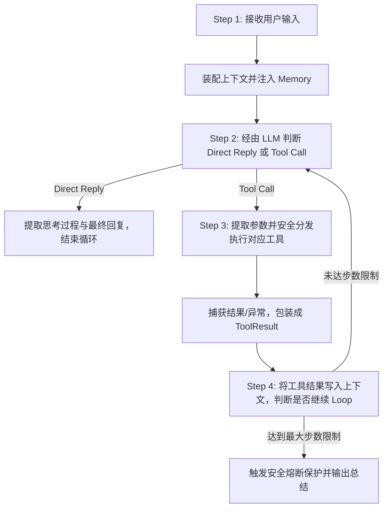

# Zero-Framework Minimal Agent Runtime (v2 Architecture)

> 2026 年 Agent Harness 技术笔试题实现 —— 基于 **DeepSeek API** 从零实现的最小可用自主 Agent。
> 纯手写核心 Runtime，**零依赖** LangGraph / OpenHands / OpenClaw 等现成 Agent 框架。

---

## 目录
1. [v2 架构重构与痛点解决（重点）](#v2-架构重构与痛点解决重点)
2. [项目亮点](#项目亮点)
3. [系统架构设计](#系统架构设计)
4. [核心执行循环 (4-Step Loop)](#核心执行循环-4-step-loop)
5. [Memory 机制设计：召回时机与放置方式](#memory-机制设计召回时机与放置方式)
6. [工具系统 (Tool Registry)](#工具系统-tool-registry)
7. [多 Session 窗口隔离与持久化](#多-session-窗口隔离与持久化)
8. [Context 原子化轮次管理与定长压缩](#context-原子化轮次管理与定长压缩)
9. [快速上手指南](#快速上手指南)
10. [测试用例验证 (28 项全部通过)](#测试用例验证-28-项全部通过)
11. [安全规范](#安全规范)

---

## v2 架构重构与痛点解决（重点）

针对评审反馈中的 5 大核心痛点，本项目已完成深度复盘与全链路重构，详细复盘报告见 [**`V2_REFACTOR_POSTMORTEM.md`**](file:///d:/interview_test/V2_REFACTOR_POSTMORTEM.md)：

1. **原子轮次切分 (Atomic Turn-Based Compaction)**：
   - 彻底解决“压缩按条数切开导致 `assistant(tool_calls)` 与 `role="tool"` 结果脱节引发 API 400 校验错误”的致命问题；
   - 引入 `TurnBlock` 数据模型，将一轮完整的 `[User -> Assistant Tool Calls -> Tool Observations -> Final Reply]` 视作不可分割的原子单元，截断压缩永远仅发生在整轮边界。
2. **定长滚动预算摘要 (Rolling Budget Summary)**：
   - 彻底解决“摘要只增不减导致长程对话 Token 膨胀”的问题；
   - 引入硬性字符预算上限（如 800 字符），超出时触发二级合并与剪枝，维持 $O(1)$ 恒定空间开销。
3. **SQLite 进程持久化 (SQLiteStorage)**：
   - 彻底解决“数据在内存字典，进程退出即消失”的问题；
   - 基于 Python 原生标准库 `sqlite3` 实现会话、消息、待办事项和滚动摘要全量落盘，进程重启无损恢复。
4. **级联物理清理 (Cascade Deletion)**：
   - 彻底解决“删掉 session 该窗口 Todo 仍残留”的孤儿数据漏洞；
   - 删除 Session 时在单次原子事务内连带物理清空该窗口的所有 Todo 与上下文。
5. **SessionState 驱动运行时状态机**：
   - 彻底解决“SessionState 未参与运行”的割裂问题；
   - 作为运行时唯一真实状态源 (Single Source of Truth)，直接驱动 `idle -> running -> idle/error` 状态机跃迁，实时跟踪 `current_step` 与 `turn_count`。

---

## 项目亮点

- **真正的从零构建 (Zero-Framework)**：自行设计并实现 Agent Runtime、事件循环、工具调度器、上下文压缩器与多会话管理器。
- **真实 LLM 驱动**：全面对接 **DeepSeek API** (`deepseek-chat`)，支持原生 Function Calling 及思考过程（Reasoning/Thought）提取。
- **真正的多会话落盘与级联隔离**：基于 SQLiteStorage 物理隔离会话、上下文与待办事项，支持进程重启恢复与级联清理。
- **安全可控的工具执行**：内置 `SafeCalculator`（基于 Python AST 解析语法树，严禁 `eval()` 杜绝代码注入攻击）。
- **完善的测试覆盖**：**28 个**全方位单元测试、痛点专项测试与真实 API 端到端集成测试，测试通过率 100%。

---

## 系统架构设计

```
┌───────────────────────────────────────────────────────────────┐
│                       Agent Runtime                           │
│  ┌────────────────┐     ┌────────────────┐     ┌───────────┐  │
│  │ SessionManager │ ──> │ ContextManager │ ──> │ DeepSeek  │  │
│  │ (Window 1/2)   │     │ (TurnBlock/    │     │ Client    │  │
│  └───────┬────────┘     │  RollingSummary│     └─────┬─────┘  │
│          │              └────────────────┘           │        │
│          ▼                                           │        │
│  ┌────────────────┐                         Loop Decision     │
│  │ SQLiteStorage  │                   ┌──────────────────────┐│
│  │ (data/agent.db)│                   │ Direct vs Tool Call? ││
│  └────────────────┘                   └──────────┬───────────┘│
│                                     Tool Call    │            │
│                                ┌─────────────────┴────────┐   │
│                                ▼                          ▼   │
│                       ┌─────────────────┐        ┌───────────┐│
│                       │  Tool Registry  │        │FinalAnswer││
│                       │ ┌─────────────┐ │        │+ TraceLog ││
│                       │ │ calculator  │ │        └───────────┘│
│                       │ │ search      │ │                     │
│                       │ │ todo (DB)   │ │                     │
│                       │ │ weather     │ │                     │
│                       │ └─────────────┘ │                     │
│                       └────────┬────────┘                     │
│                                │                              │
│                                └──────> Atomic Turn Loop ─────┘
```

---

## 核心执行循环 (4-Step Loop)

运行时严格按照题目要求的 4 步循环执行：



- **Step 1（接收输入）**：接收用户 Prompt，通过 `SessionManager` 定位到独立窗口会话，写入该 Session 的上下文管理器，状态机置为 `running`。
- **Step 2（自主决策与解析）**：调用 DeepSeek 模型，基于注册工具的 JSON Schema 自主决策是直接回答还是调用工具；解析出思考过程（`thought`）、函数调用（`tool_calls`）或回答。
- **Step 3（工具执行与容错）**：`ToolRegistry` 动态查找并安全执行工具。捕获任何参数异常或运行时异常，将错误作为 Observation 反馈给模型，实现自愈自纠错。
- **Step 4（循环判断与终结）**：若工具产生结果，以 `role="tool"` 塞回上下文，再次触发 Step 2，由模型观察结果并决定下一步行动，直至模型输出最终回复或达到最大迭代步数（防死循环熔断）。最后状态机复位为 `idle` 并自增轮次。

---

## Memory 机制设计：召回时机与放置方式

长效记忆（Memory）对于长程任务和跨轮次对话至关重要。本项目系统设计如下：

### 1. 记忆的召回时机 (Recall Timing)

| 召回阶段 | 触发时机 | 机制与策略 | 适用场景 |
|---------|---------|-----------|---------|
| **静态预置召回 (Pre-turn Retrieval)** | 用户每次输入之后、LLM 生成之前 | 将用户核心静态偏好（如语言、城市、常用角色）常驻或通过关键词命中召回 | 用户基础画像、全局偏好 |
| **动态意图召回 (On-demand Tool Retrieval)** | Agent 执行 Step 2 决策时 | 当用户提到“我上周说的那件事”时，Agent 自主调用 `memory_search` 工具去持久化知识库检索 | 历史碎片事实、久远对话细节 |

### 2. 记忆的放置方式 (Placement Strategy)

```
[System Prompt]
  ├── System Base Instructions (系统核心人设与工具使用原则)
  ├── [Long-term Memory / User Profile] (召回的用户长期记忆，置于系统提示词中段)
  └── [Rolling Summary of Prior Conversation] (因窗口超限触发的定长滚动摘要)
[Conversation Context (Atomic Turn Blocks)]
  ├── Recent Complete Turn 1
  └── Recent Complete Turn 2 (包含完整成对的 user / assistant tool_calls / tool obs / reply)
```

---

## 工具系统 (Tool Registry)

所有工具包含**名称 (name)**、**功能描述 (description)** 和符合 JSON Schema 规范的**参数描述 (parameters)**。

| 工具名称 | 功能描述 | 参数要求 | 容错/持久化设计 |
|---------|---------|---------|-------------|
| `calculator` | 安全数学表达式计算 | `expression: str` | 基于 Python `ast` 抽象语法树解析，禁用 `eval()`，支持四则运算与三角对数函数 |
| `search` | 知识与全网搜索 | `query: str` | 内置模拟数据与兜底泛化引擎，提供结构化信息 |
| `todo` | 待办事项 CRUD（增删查改） | `action: str, title: str?, todo_id: int?, priority: str?` | 支持 `add`, `list`, `complete`, `delete`，**持久化入库，严格按 Session 隔离且支持级联清理** |
| `weather` | 城市天气与气温查询 | `city: str` | 查询指定城市（广州、厦门、北京、上海等）天气概况 |

---

## 快速上手指南

### 1. 环境准备

需要 Python 3.10+（开发测试环境为 Python 3.13）。

```bash
# 1. 克隆代码仓库
git clone https://github.com/luhaiquan23-cs/interview-test.git
cd interview-test

# 2. 安装依赖
pip install -r requirements.txt
```

### 2. 配置环境变量

从模板创建 `.env` 文件，并填入您的 DeepSeek API Key：

```bash
cp .env.example .env
```

`.env` 文件内容：
```env
DEEPSEEK_API_KEY=your_deepseek_api_key_here
DEEPSEEK_BASE_URL=https://api.deepseek.com
DEEPSEEK_MODEL=deepseek-chat
```

> **安全须知**：`.env` 文件已被 `.gitignore` 排除，**切勿将真实 API Key 提交至 Git 仓库**！

### 3. 运行交互式 Agent

```bash
python main.py
```

终端支持丰富指令：
- `/session <id>`：切换或新建会话窗口（如 `/session window_1`）
- `/sessions`：查看当前所有活跃窗口与状态
- `/todos`：快速查看当前窗口的待办事项
- `/delete <session_id>`：**级联物理删除指定窗口及下辖所有待办与消息**
- `/trace`：开启/关闭底层详细 Step 跟踪
- `/memory <text>`：为当前会话注入一条长期记忆
- `/reset`：清空当前会话上下文
- `/exit`：退出程序

---

## 测试用例验证 (28 项全部通过)

本项目提供完备的自动化测试体系：

```bash
# 运行全部 28 个测试（包含 19 个经典单元测试 + 5 个针对面试官反馈的重构专项测试 + 4 个真实 API 端到端测试）
python -m pytest -v

# 运行 v2 重构专项测试套件
python -m pytest tests/test_v2_improvements.py -v
```

### 测试用例覆盖明细：
- `tests/test_v2_improvements.py`: 5 个重构针对性测试（原子轮次防切散、滚动摘要有界、SQLite 跨进程恢复、级联清理孤儿 Todo、状态机跃迁）
- `tests/test_tools.py`: 8 个用例（AST 运算、安全防护、Search 检索、Todo CRUD 与隔离等）
- `tests/test_context.py`: 4 个用例（基础对话流、长期记忆注入、原子化轮次压缩、多轮追问保真）
- `tests/test_session.py`: 3 个用例（窗口 1 与窗口 2 隔离、会话重连恢复、生命周期）
- `tests/test_runtime_mock.py`: 4 个用例（Step 2 直接回复、Step 3/4 工具调用与闭环循环、最大步数熔断、未注册工具异常自愈）
- `tests/test_agent_e2e.py`: 4 个用例（基于真实的 DeepSeek API 验证：纯对话响应、计算器工具调用与数值核验、待办事项创建与追问、多会话独立操作验证）

---

## 安全规范

- **API 凭证保护**：代码中使用 `python-dotenv` 动态读取，无任何明文硬编码；Git 严格忽略 `.env`。
- **代码安全沙箱**：工具端彻底摒弃 `eval()`，采用安全语法分析解析数学公式。
- **执行防护**：限制单轮最大推理步数（默认 6 步），杜绝因工具递归调用产生的高额 API Token 消耗。
